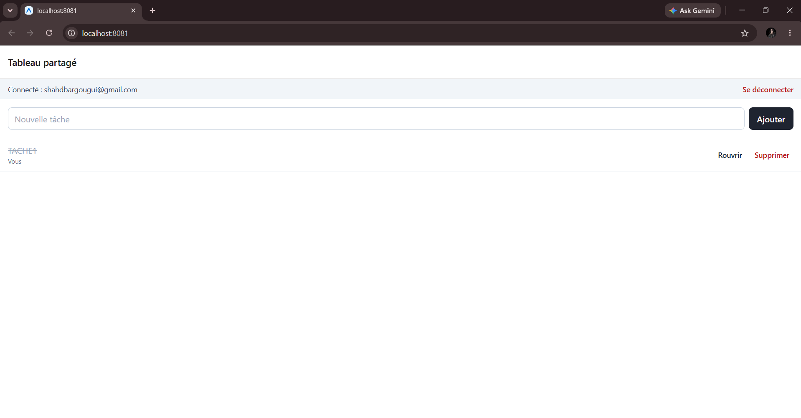
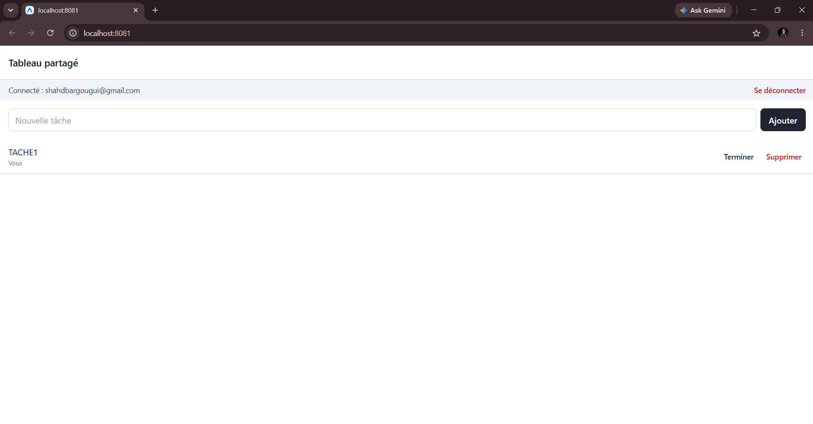

# s4-taskboard

Séance 04 - Shared Task Board (Firebase) (IAM2, React Native avec Expo)

## Auteur

Shahd Bargougui

## Binôme

Travail seul (projet Firebase : `iam2-rn-shahd-bargougui`)

## Ce qui est réalisé

- Configuration Firebase par variables EXPO_PUBLIC_ dans .env (non commité), modèle .env.example commité
- Inscription, connexion et déconnexion par e-mail et mot de passe, session conservée après redémarrage
- Porte d'entrée avec Stack.Protected et un AuthContext alimenté par onAuthStateChanged
- Tableau de tâches partagé en temps réel avec onSnapshot : ajouter, terminer, supprimer
- Règles de sécurité (fichier firestore.rules) : lecture pour les comptes connectés, modification et suppression par la personne qui a créé la tâche, titre de 1 à 80 caractères
- Défi (assignation et filtre « Mes tâches ») : non fait

## Lancer le projet

1. npm install
2. Copier .env.example en .env et renseigner la configuration Web d'un projet Firebase (connexion par e-mail et mot de passe activée, base Firestore créée)
3. Publier le contenu de firestore.rules dans l'onglet Règles de Firestore Database
4. npx expo start, puis scanner le QR code avec Expo Go

## Captures d'écran





## Environnement

- Expo SDK : 57
- Firebase JS SDK : 12.19.0
- Téléphone : Android / iOS
- Expo Go : 57.0.0

## Sortie de npx expo-doctor@latest

```
Running 21 checks on your project...
21/21 checks passed. No issues detected!
```
